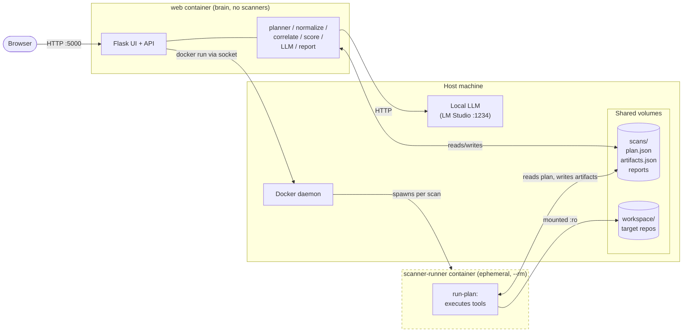
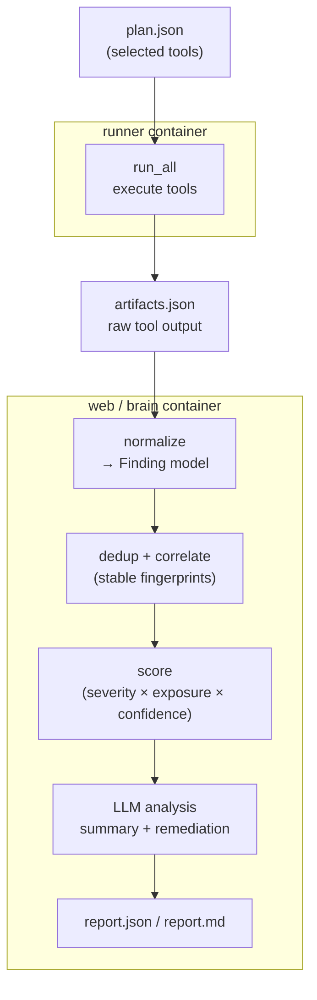
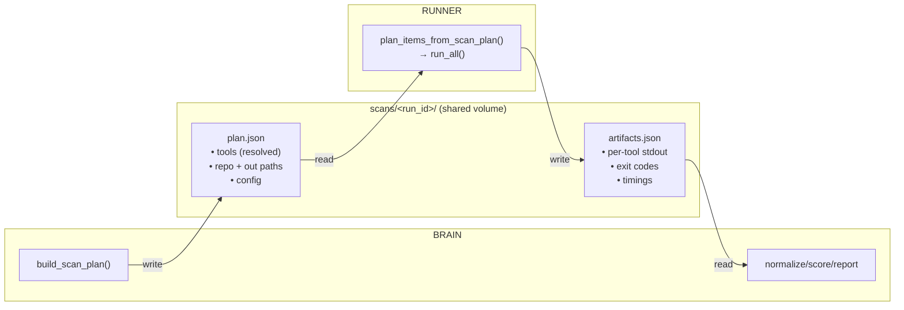
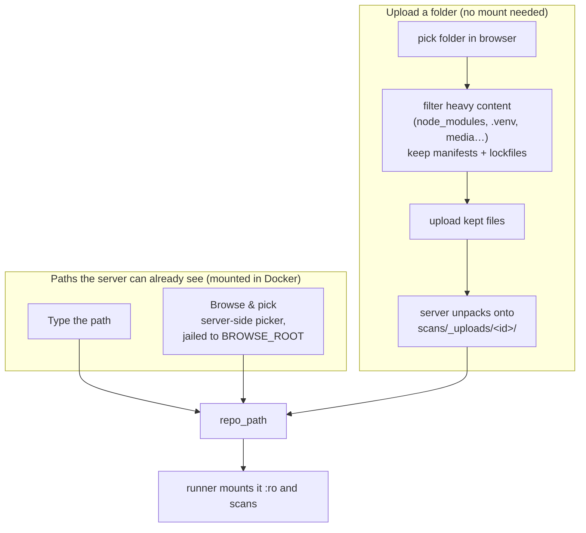

# Architecture Overview

A plugin-based security scanning pipeline. It detects a project's environment,
runs the right scanners (SAST, dependencies, secrets, container, network),
normalizes everything into a single finding model, scores it, and uses a local
LLM to triage and summarize.

The system is **two-tier**: a lightweight **brain** (UI + planning + analysis,
no scanners) and an ephemeral **scanner-runner** (all scanners, executes a plan
and exits). The brain never runs scanners itself; the runner never plans or
calls the LLM.

---

## 1. Container topology

The web/brain container holds the UI and all the "thinking". For each scan it
launches a throwaway scanner-runner on the **host** Docker daemon (via the
mounted socket) and exchanges files over a shared volume.



Plain-text view of the same idea:

```
Browser ──HTTP──> [ web container: UI + BRAIN ]
                        │  (no scanners)
                        │ docker run … (host socket)
                        ▼
                  [ HOST Docker daemon ]
                        │ spawns per scan
                        ▼
                  [ scanner-runner ]  ← ephemeral, --rm, scanners only
                        │
        shared "scans" volume:  plan.json → (runner) → artifacts.json
```

> **Key point:** the runner is a *sibling* of the web container, not a child.
> The web container has no Docker engine of its own — it drives the host daemon
> through `/var/run/docker.sock`.

---

## 2. Scan lifecycle (sequence)

```mermaid
sequenceDiagram
    actor U as User (browser)
    participant W as Web API (Flask)
    participant B as Brain (scan_manager)
    participant D as Host Docker daemon
    participant R as scanner-runner
    participant L as Local LLM

    U->>W: POST /api/scan (repo_path / upload)
    W->>B: create_job + start_job
    Note over B: 1. PLAN (in-process)
    B->>B: env detect + select tools
    opt auto-scan
        B->>L: which tools fit this repo?
        L-->>B: tool list
    end
    B->>B: write plan.json (scans volume)

    Note over B,R: 2. EXECUTE (delegated)
    B->>D: docker run … run-plan --plan plan.json
    D->>R: start container (target mounted :ro)
    R->>R: run each tool (LivePlugin / NetworkPlugin)
    R->>B: write artifacts.json (scans volume); exit
    R-->>D: container removed (--rm)

    Note over B: 3. ANALYSE (in-process)
    B->>B: normalize → correlate → score
    B->>L: summarize + remediate top findings
    L-->>B: executive summary + guidance
    B->>B: write report.json / report.md

    U->>W: GET /scans/<id>/report
    W-->>U: findings + summary
```

---

## 3. The analysis pipeline

What happens to scanner output once the runner produces `artifacts.json`. The
first stage runs in the **runner**; everything after runs in the **brain**.



| Stage | Module | Role |
|-------|--------|------|
| Plan | `planner.py` (`build_scan_plan`, `select_tool_defs`) | Decide which tools to run; with `--auto-scan`, `auto_planner.py` + `env_detect.py` (optionally LLM) pick them. |
| Execute | `runner.py` (`run_all`) + `plugins/` | Each `LivePlugin` runs one tool from `tools_registry.yaml`; `NetworkPlugin` handles nmap. |
| Normalize | `normalize.py` | SARIF / JSON / XML → unified `Finding` (`models.py`). |
| Correlate | `correlate.py` | Deduplicate and link related findings. |
| Score | `scoring.py` | Risk score from severity, exposure, confidence. |
| Triage | `llm_analysis.py` + `llm_client.py` | Executive summary + per-finding remediation via local LLM. |
| Report | `report.py` | `report.json` (machine) and `report.md` (human). |

---

## 4. Brain ↔ runner contract (IPC)

The two containers never call each other over the network — they exchange two
files on the shared `scans` volume (`orchestrator/ipc.py`).



`artifacts.json` embeds each tool's `stdout`, so the brain can normalize
findings without needing the runner's raw files. Paths inside `plan.json` are
**runner-container** paths (e.g. `/scan/target`), resolved by the brain.

---

## 5. Getting the target into the scanner

Three ways to set `repo_path`. Two reference a path the server can already see
(a mount, in Docker); the third uploads the code so no mount is needed. All end
with the runner mounting a directory the host daemon can see.



- **Type or browse** — both yield a path the server must be able to read. In
  Docker that means it sits under a mounted dir (`WORKSPACE_DIR`) following the
  docker-out-of-docker identical-path rule (see `DOCKER.md`). The **Browse…**
  picker (`web/browse.py`, `GET /api/browse`) lists folders server-side, jailed
  to `BROWSE_ROOT` (falls back to `WORKSPACE_DIR`, then the home dir), shows only
  directories, badges likely project roots, and blocks path traversal.
- **Upload** (`web/upload.py`): the browser filters out heavy folders *before*
  upload; the server re-filters and unpacks onto the scans volume — no path
  rules. Uploads are cleaned up when their run is deleted, and stale orphans are
  swept on each new scan (`UPLOAD_MAX_AGE_HOURS`, default 24h).

---

## 6. Code map

```
orchestrator/                  # the engine (used by both CLI and brain)
  main.py                      #   CLI: `scan` (all-in-one) | `run-plan` (runner)
  config.py                    #   config + ToolDefinition / ToolsRegistry
  models.py                    #   Finding, RawScanArtifact, ScanResult
  env_detect.py                #   detect languages / package managers / docker
  planner.py                   #   selection + build_scan_plan / rebuild
  auto_planner.py              #   env + (optional) LLM tool selection
  ipc.py                       #   ScanPlan + plan.json / artifacts.json IO
  runner.py                    #   run_all(): execute plan items
  plugins/                     #   LivePlugin, NetworkPlugin, *_stub
  normalize.py correlate.py scoring.py
  llm_client.py llm_analysis.py report.py

web/                           # the brain + UI (lightweight image)
  app.py                       #   Flask app / page routes
  api/routes.py                #   /api/* (scan, upload-repo, browse, tools, env-detect…)
  scan_manager.py              #   2-tier driver: plan → run runner → analyse
  upload.py                    #   folder-upload filtering + cleanup helpers
  browse.py                    #   server-side directory picker (jailed to BROWSE_ROOT)
  templates/  static/          #   UI

Dockerfile                     # scanner-runner image (scanners + orchestrator)
web/Dockerfile                 # web/brain image (UI + orchestrator, no scanners)
docker-compose.yml             # wires the two images together
tools_registry.yaml            # catalog of scanner tools + command templates
```

---

## 7. Deployment modes

| Mode | How | When |
|------|-----|------|
| **Two-tier (Docker)** | `docker compose --profile runner build` then `up -d` | Normal use; isolation + small web image. See `DOCKER.md`. |
| **All-in-one CLI** | `python -m orchestrator.main scan --repo … --auto-scan` | Local dev / CI; plans, runs, and analyses in one process (scanners installed locally). |

The `run-plan` subcommand is the runner's entry point; the `scan` subcommand is
the single-process path that does the whole pipeline at once.