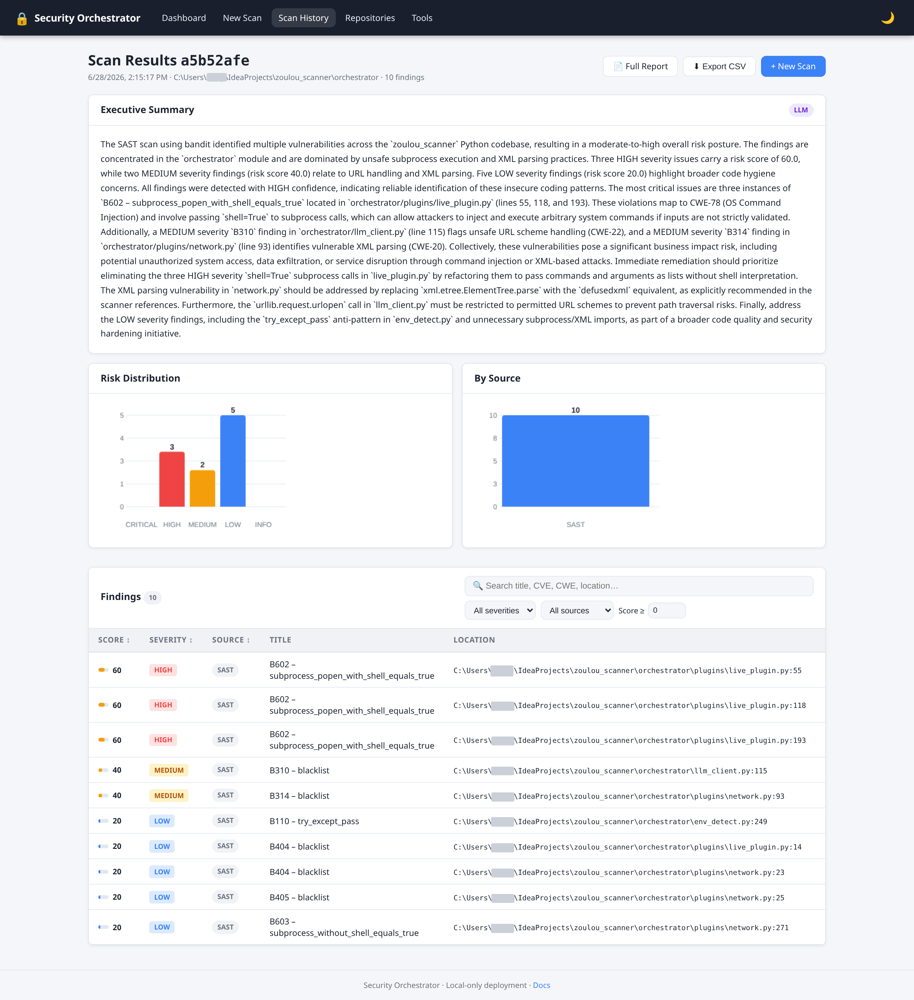
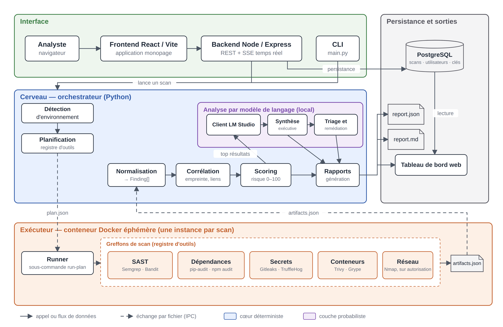
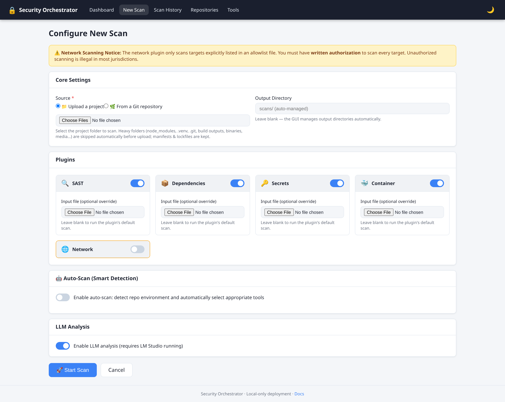
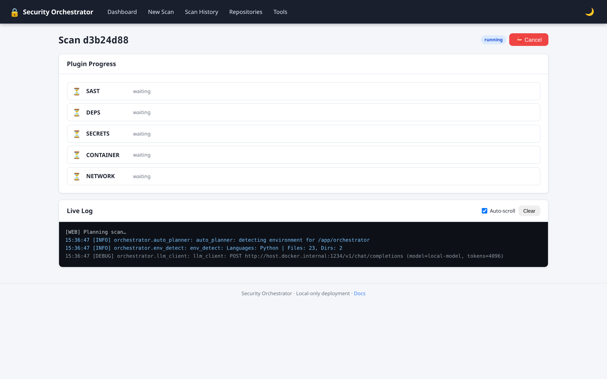
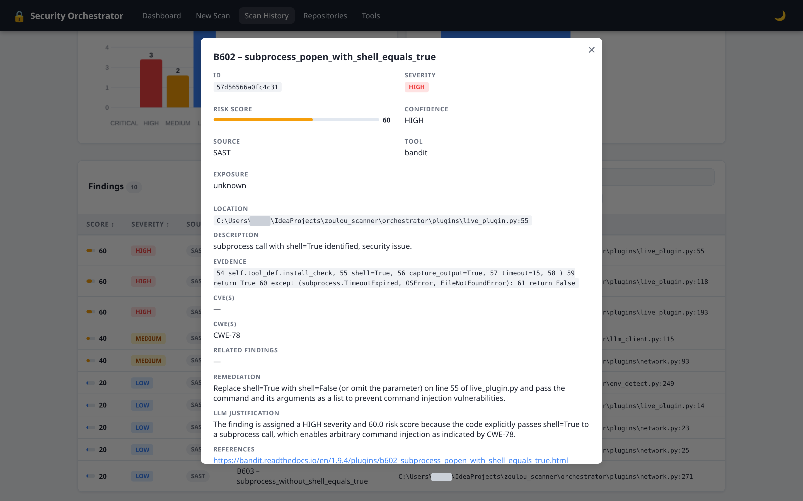

# Zoulou Scanner

**A security scan orchestrator that runs multiple scanners, merges their findings into one prioritised report, and explains them with a local LLM that never sees the network.**

[](https://github.com/ilyass-cloud/zoulou-scanner/actions/workflows/ci.yml)


> **En bref (FR)** — Zoulou Scanner lance automatiquement plusieurs scanners de sécurité (code, dépendances, secrets, conteneurs, réseau), rassemble leurs résultats dans un format unique, supprime les doublons, attribue à chaque problème une note de risque de 0 à 100 calculée de façon reproductible, puis les explique grâce à un modèle de langage exécuté localement. Principe directeur : **le calcul décide, l'IA explique.** Projet de fin d'études du Master Ingénierie Informatique, Cybersécurité et Intelligence Artificielle (Université Ibn Tofaïl, 2025–2026).



---

## Why

Securing an application takes several tools — one for source code, one for dependencies, one for leaked secrets, one for container images, one for the network. Each produces its own report in its own format, with duplicates and no common notion of priority. The analyst ends up with hundreds of alerts and one question: *where do I start?*

Zoulou Scanner answers that question without sending your code or your vulnerabilities to a third-party service.

## Features

- **Orchestration** — runs 10 scanners across 5 families; adding a scanner is a configuration change (`tools_registry.yaml`), not a code change.
- **Unified data model** — every native output (SARIF, pip-audit, npm audit, Safety, Gitleaks, TruffleHog, Trivy, Grype, Nmap XML) is normalised into one `Finding` model, deduplicated by a deterministic SHA-256 fingerprint and correlated across tools.
- **Explainable risk score (0–100)** — a transparent, reproducible formula; every point can be traced back to its cause.
- **Local, guarded LLM** — executive summary and per-finding remediation from a model served locally (LM Studio, OpenAI-compatible API). The model never computes the score, answers in a structured format, and a finding without evidence is never sent to it.
- **Isolated execution** — scanners run in an ephemeral Docker container per scan, with the target mounted read-only.
- **Web UI** — configure, launch and follow scans live, browse results, export reports (Markdown, JSON, CSV). A CLI exposes the same pipeline for CI use.
- **Hardened** — the tool was audited against itself (see [Security](#security)).

## How it works

```
Detect → Plan → Run (isolated) → Normalise → Deduplicate & correlate → Score → Explain → Report
└──────────────────────── deterministic ────────────────────────────────┘   LLM    └ outputs ┘
```

The **brain** (Python) plans the scan and analyses the results; the **executor** (an ephemeral Docker container holding the scanners) runs it. They exchange two files only: `plan.json` and `artifacts.json`.



### Risk score

```
score = clamp( severity_base + exposure_boost − low_confidence_penalty + correlation_boost , 0, 100 )
```

| Term | Value |
|---|---|
| Severity base | critical 80 · high 60 · medium 40 · low 20 · info 5 |
| Exposure boost | +15 if the affected service is reachable on the network |
| Low-confidence penalty | −10 if the finding is likely a false positive |
| Correlation boost | +5 per risk-raising link (e.g. vulnerable package ↔ exposed service), capped at +15 |

Two tools reporting the same issue do **not** make it more severe: corroboration only lifts the confidence penalty. Confidence (“is it real?”) and risk (“how bad is it?”) are kept on separate axes.

### LLM guardrails

- The model **explains**; it never ranks or scores.
- It only receives normalised, scored findings together with their evidence, and must answer in a fixed JSON structure.
- **No evidence, no answer**: findings without evidence are not sent to the model; the program itself writes *“insufficient evidence”*.
- Everything runs locally — no code or finding leaves the machine. Without an LLM, the full ranked report is still produced (`--no-llm`).

## Supported scanners

| Family | Tools |
|---|---|
| Static analysis (SAST) | Semgrep, Bandit |
| Dependencies (SCA) | pip-audit, npm audit, Safety |
| Secrets | Gitleaks, TruffleHog |
| Containers | Trivy, Grype |
| Network | Nmap (allowlist-restricted, passive inventory only) |

## Quick start

### Windows (one click)

1. Install and start [Docker Desktop](https://www.docker.com/products/docker-desktop/).
2. Double-click **`LANCER_ZOULOU.bat`** — the first run builds the images (10–20 min).
3. The browser opens on <http://localhost:5000> (default login `admin` / `changeme` — change it).

`ARRETER_ZOULOU.bat` stops everything. Step-by-step guide in French: [`LISEZ-MOI_LANCEMENT.txt`](LISEZ-MOI_LANCEMENT.txt).

### Docker Compose (any OS)

```bash
docker compose --profile runner build   # builds the web image and the scanner-runner image
docker compose up -d                    # web UI + PostgreSQL on http://localhost:5000
```

See [DOCKER.md](DOCKER.md) for configuration (paths, LLM endpoint, credentials).

### Command line (no Docker, sample data)

```bash
pip install pydantic pyyaml
python -m orchestrator.main scan --repo . --config examples/config.yaml --out out/ \
  --network-allowlist examples/allowlist.txt --network-input examples/sample_nmap.xml --no-llm
```

Full CLI, configuration and API reference: [docs/USAGE.md](docs/USAGE.md). Architecture notes: [ARCHITECTURE.md](ARCHITECTURE.md).

## Screenshots

| Launch a scan | Follow it live | Finding detail |
|---|---|---|
|  |  |  |

## Security

The orchestrator executes processes, reads untrusted repositories and exposes a web API — so it was audited like any other target (OWASP categories, CVSS v3.1, every finding reproduced before being retained). **17 findings** were fixed, each with a regression test, including:

- an unauthenticated remote-command-execution chain (API authentication, commands built as argument lists without a shell);
- a bypass of the network allowlist (scanner flags rejected, authorisation resolved *before* scanning);
- several **silent failures**, where the tool reported “no findings” although a scanner had not really run.

CVSS vectors of all findings are versioned in [`docs/audit_findings.json`](docs/audit_findings.json) and recomputed by [`scripts/cvss31.py`](scripts/cvss31.py).

> ⚠️ Only scan code and hosts you are **authorised** to test. The network plugin refuses any target missing from the allowlist.

## Tests

**468 automated tests** — 360 Python (core), 64 Node (backend), 44 React (frontend) — run on every push by GitHub Actions. The count is recorded in [`docs/test_counts.json`](docs/test_counts.json) and checked by CI.

```bash
python -m pytest tests/             # core
cd web/server && npm test           # backend
cd web/client && npm test           # frontend
```

The approach was also evaluated on three intentionally vulnerable applications (DVPWA, PyGoat, OWASP Juice Shop): see [`examples/evaluation_tiers`](examples/evaluation_tiers).

## Known limitations

- Without network data, the score mostly follows the severity reported by the scanners, which tends to rank library CVEs above code-level flaws (e.g. Juice Shop's best-known SQL injection ranks 161st of 315).
- The score coefficients are expert choices, not yet calibrated on real-world data.
- The quality of LLM explanations was assessed on a small sample; a local model is less capable than frontier models.
- Planned: exploit-likelihood signals (EPSS, CISA KEV), CWE weighting, dependency reachability, CVE/GHSA de-duplication, retrieval-augmented explanations, an external audit.

## About

Master's final project (*Projet de fin d'études*) — **Master in Computer Engineering, Cybersecurity and Artificial Intelligence**, Faculty of Sciences, Université Ibn Tofaïl, Kénitra (Morocco), 2025–2026. Supervised by **Pr. Adil HILMANI**.

The thesis itself (in French) is not included in this repository; some code comments still refer to its sections.

**Use of AI tools.** The subject, design, architecture and development of the tool are my own work. Claude (Anthropic) was used during the validation phase — security audit, test writing and the resulting fixes — and to help with the writing, proofreading and layout of the thesis. All content was reviewed by the author.

## License

[MIT](LICENSE) © 2026 Ilyass BARBOUR
